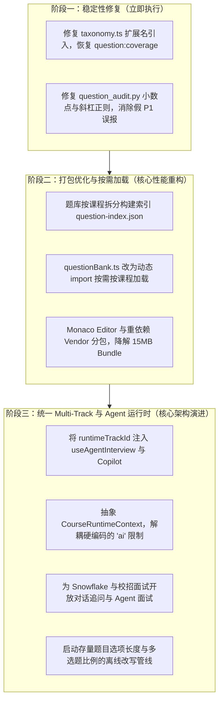

# AI 面试训练器（ai-interview-trainer）代码库深度分析与架构缺陷评估报告

**审计时间**：2026-11-23  
**代码库版本**：v1.2.7 (Commit: `2cd2360` 及校招 500 题体系)  
**审计范围**：系统架构、前端打包与运行时性能、多课程（Multi-Track）体系隔离、Agent/Copilot 统一决策管线、数据持久化、题库质量门禁与工程工具链。

> **后续题库扩展记录（2026-11-24）**：本报告的审计基线截止于 2026-11-23，当时校招课程为 500 题。随后在 `campus-employment` 课程下新增 150 道初级/中级情境题，当前校招题库实际累计 785 道（255 初级、430 中级、100 困难；555 单选、230 多选），其中包括此前已在自动加载目录但未纳入统计的 135 道企业情境题。本次扩展沿用原有 15 个知识主题，不改变课程 taxonomy；相关实时题量以课程题库和 [650 题覆盖说明](docs/campus-employment-question-coverage-785.md) 为准。以下架构分析仍按原审计时点记录，不应将其中的 500 题描述理解为当前数量。

---

## 目录

1. [执行概要 (Executive Summary)](#1-执行概要-executive-summary)
2. [重大缺陷与风险总览 (Issue Matrix)](#2-重大缺陷与风险总览-issue-matrix)
3. [核心架构与工程缺陷深度分析](#3-核心架构与工程缺陷深度分析)
   - [缺陷一：静态全量内联打包与初始化阶段主线程阻塞（高危性能瓶颈）](#缺陷一静态全量内联打包与初始化阶段主线程阻塞高危性能瓶颈)
   - [缺陷二：多课程体系与核心 Agent 运行时架构割裂（高危架构缺陷）](#缺陷二多课程体系与核心-agent-运行时架构割裂高危架构缺陷)
   - [缺陷三：Node 24 原生 ESM 模块解析失败导致核心脚本崩溃（高危工具故障）](#缺陷三node-24-原生-esm-模块解析失败导致核心脚本崩溃高危工具故障)
   - [缺陷四：跨语言审计脚本归一化不一致导致的伪 P1 误报（中度工程缺陷）](#缺陷四跨语言审计脚本归一化不一致导致的伪-p1-误报中度工程缺陷)
   - [缺陷五：单例学习者画像在多课程扩展下的聚合与一致性风险（中度架构缺陷）](#缺陷五单例学习者画像在多课程扩展下的聚合与一致性风险中度架构缺陷)
   - [缺陷六：题库质量与门禁规则的严重存量合规债务（中度质量债务）](#缺陷六题库质量与门禁规则的严重存量合规债务中度质量债务)
   - [缺陷七：客户端凭证安全与环境特定链路脆弱性（中度安全隐患）](#缺陷七客户端凭证安全与环境特定链路脆弱性中度安全隐患)
4. [架构改进建议与实施路线图 (Remediation Roadmap)](#4-架构改进建议与实施路线图-remediation-roadmap)

---

## 1. 执行概要 (Executive Summary)

本项目是一个设计理念高度先进的 AI 面试训练单页应用（SPA）。引入了基于 `@earendil-works/pi-agent-core` 的统一决策运行时、基于 Dexie (IndexedDB) 的 Learner Memory 动态薄弱项追踪，以及确定性规则（选择题判分、知识点覆盖）与 LLM 模糊推理（开放题评估、动态追问）严格分离的分层设计。

全套自动化单元测试表现优异（**55 个测试套件，716 个测试用例全部通过**，变异测试 Mutation Check 11/11 全部捕获，`tsc` 类型检查全绿）。

然而，随着题库规模从初期的百道题膨胀到当前的 **4,429 道题（127 个 JSON 文件）与 95 个离线变体池**，且课程体系从单一 AI 领域横向扩展至 **AI、Snowflake、Security Architecture、校招面试（Campus Employment）** 四大独立课程，系统暴露出了**严重的打包性能瓶颈、多课程体系与 Agent 运行时的架构割裂、CLI 脚本解析失效，以及显著的题库质量债务**。

---

## 2. 重大缺陷与风险总览 (Issue Matrix)

| 编号 | 类别 | 严重级别 | 缺陷标题 | 核心影响与症状 |
| :--- | :--- | :---: | :--- | :--- |
| **D-01** | 性能 / 打包 | **P0 致命** | 全量 JSON 静态内联打包，初始化同步跑 4,429 次 Zod 校验 | 单 bundle 体积高达 **15.15 MB** (Gzip 3.37 MB)，主线程严重卡顿，移动端 FCP/TTI 恶化 |
| **D-02** | 架构 / 业务 | **P1 高危** | Agent 面试与 Copilot 侧栏硬编码仅支持 AI，与多课程体系割裂 | 新增课程（校招 500 题、Snowflake 1000+ 题）无法使用核心的 Agent 面试、追问与 Copilot 功能 |
| **D-03** | 工程 / 工具 | **P1 高危** | Node 24 ESM 缺失扩展名导致 `question:coverage` 与 `blueprint` 崩溃 | `npm run question:coverage` 报 `ERR_MODULE_NOT_FOUND`，题库生产管线第一步瘫痪 |
| **D-04** | 工具 / 审计 | **P2 中度** | Python 审计脚本正则过度清洗，误报 2 处伪 P1 `duplicate-option` | 小数点与斜杠被去重正则吞噬（`6.5%` vs `65%`），与 TS 校验脚本逻辑分叉 |
| **D-05** | 架构 / 存储 | **P2 中度** | Dexie 中 `StoredLearner` 使用全局单例，跨课程依靠内存动态投影 | 画像聚合字段混合，进行中 Agent 草稿仅保留 AI 画像，多课程扩展受限 |
| **D-06** | 质量 / 门禁 | **P2 中度** | 单选题占比（48.1%）严重超标，1,173 题存在选项长度泄题 | 严重违反 `AGENTS.md` §4.2 题型门禁（目标单选 ≤ 33.3%），近 1/4 题目可通过长度套路猜中答案 |
| **D-07** | 安全 / 部署 | **P3 低度** | API Key 明文裸存 `localStorage`；Copilot CLI 强绑定开发环境 | 客户端凭证存在 XSS 暴露面；生产静态部署（GitHub Pages/Cloudflare）下 Copilot 缺少禁用说明 |

---

## 3. 核心架构与工程缺陷深度分析

### 缺陷一：静态全量内联打包与初始化阶段主线程阻塞（高危性能瓶颈）

#### 1. 现象与证据
执行 `npm run build` 生成的客户端 bundle 详情：
- `dist/assets/index-BEBb_v5p.js`：**15,153.05 kB**（约 **15.15 MB**，Gzip 后仍然高达 **3,372.79 kB**）
- 整体 `dist/assets` 产物体积接近 **80 MB**（含 Monaco Editor 全语言 worker）

#### 2. 根因剖析
在 [src/data/questionBank.ts](file:///Users/saga/code-repos/ai-interview-questions/src/data/questionBank.ts#L12-L32) 与 [src/data/variantBank.ts](file:///Users/saga/code-repos/ai-interview-questions/src/data/variantBank.ts#L10-L37) 中：
```typescript
const modules = import.meta.glob('./questions/*.json', {
  eager: true,
  import: 'default',
}) as Record<string, unknown[]>;
```
- 项目包含 **127 个题目 JSON 文件（磁盘体积 11 MB）** 与 **95 个变体 JSON 文件（磁盘体积 5 MB）**。
- `eager: true` 迫使 Vite 在构建时将整整 **16 MB 的原始文本** 全部内联到了单一的 JS 入口文件 `index-*.js` 中。
- **模块加载期阻塞**：代码位于模块顶层（Top-level scope），在浏览器解析该 JS 文件时：
  1. V8 引擎解析并编译 15 MB 的 JavaScript；
  2. 立即在单线程循环中同步执行 **4,429 次** `questionSchema.safeParse` 以及 **95 次** `variantPoolSchema.safeParse`；
  3. 执行 `mergePools` 构建大规模 Map/Object；
  4. 只有这一切全部完成之后，`main.tsx` 中的 `ReactDOM.createRoot` 才会开始挂载并渲染首屏。

#### 3. 架构缺陷评估
正如 `questionBank.ts` 注释所述：
> *“刻意保持简单——不建数据库/Repository/索引层；题库规模到达需要按需加载时，再引入动态 import + 构建期 question-index.json”*

题库体量目前已达到 4,429 题与数百个变体池，继续使用 `eager: true` 已经突破了该简易架构的容量上限。特别是一个仅想复习“校招面试”（500题）的用户，也必须在首屏强行下载并解析几千道 Snowflake 和 AI 深度工程题。

---

### 缺陷二：多课程体系与核心 Agent 运行时架构割裂（高危架构缺陷）

#### 1. 现象与证据
项目 README 和架构文档宣称核心亮点是：
> *“会记住你的训练表现，并根据薄弱项动态调整下一次训练的 AI 面试教练。”*  
> *“模拟面试（对话式追问训练）：进入 interview 模式后复用与独立面试页同一套 pi-agent-core 运行时”*

然而在实际代码实现中：
1. **App 顶层状态硬编码** ([src/App.tsx#L130-L131](file:///Users/saga/code-repos/ai-interview-questions/src/App.tsx#L130-L131))：
   ```typescript
   // 强行锁死为 'ai' 课程
   const agentProfile = profile ? profileForTrack(profile, 'ai', knowledgeNodes) : null;
   const agent = useAgentInterview(config, agentProfile, handleAgentComplete, message);
   ```
2. **题库跨域泄露** ([src/hooks/useAgentInterview.ts#L538](file:///Users/saga/code-repos/ai-interview-questions/src/hooks/useAgentInterview.ts#L538))：
   ```typescript
   bank: bank.questions.filter((q) => !(config.disabledCategories ?? []).includes(q.category)),
   ```
   传入 `createInterviewAgent` 的题库是**未经课程过滤的全局 4,429 题**，但画像 `agentProfile` 却只包含 AI 领域的掌握度。
3. **完成落库强行打标为 AI** ([src/hooks/useTrainingSession.ts#L330-L335](file:///Users/saga/code-repos/ai-interview-questions/src/hooks/useTrainingSession.ts#L330-L335))：
   ```typescript
   // 面试 Agent 只属于 AI 学习体系；显式打标，避免它进入其它课程进度。
   const aiRecord: SessionRecord = {
     ...record,
     courseId: record.courseId ?? 'ai',
     questionResults: record.questionResults.map((result) => ({ ...result, courseId: result.courseId ?? 'ai' })),
   };
   ```
4. **UI 层强行拦截非 AI 课程** ([src/App.tsx#L307](file:///Users/saga/code-repos/ai-interview-questions/src/App.tsx#L307) 与 [src/App.tsx#L368](file:///Users/saga/code-repos/ai-interview-questions/src/App.tsx#L368))：
   - 导航菜单栏中，如果 `runtimeTrackId !== 'ai'`，直接将 “面试” 和 “Agent 面试” 两个 Tab 剔除。
   - 路由守卫直接将 `/interview` 或 `/agent` 重定向回 `/train`。
   - 侧边栏 Copilot 图标被彻底隐藏 ([src/App.tsx#L350](file:///Users/saga/code-repos/ai-interview-questions/src/App.tsx#L350))。

#### 2. 影响评估
当前代码库包含四大体系：
- `ai`：AI 工程与大模型
- `snowflake`：Snowflake 数据平台（含 PostgreSQL 工程，共 1,000+ 题）
- `security-architecture`：安全架构（数百题）
- `campus-employment`：最新补齐的 2025-2026 校招行为与技术面试课程（500 题）

**后三门独立课程完全被降级为“静态做题卡片”**，无法使用智能追问、对话面试、自适应 Agent 选题以及 Copilot 交互解析功能。Agent 运行时能力成为了 AI 专属的特化逻辑，未能与多课程架构达成领域模型上的统一。

---

### 缺陷三：Node 24 原生 ESM 模块解析失败导致核心脚本崩溃（高危工具故障）

#### 1. 现象与复现
运行 README 中推荐的两个日常维护命令：
```bash
$ npm run question:coverage
$ npm run question:blueprint
```
均立即以退出码 1 崩溃：
```
Error [ERR_MODULE_NOT_FOUND]: Cannot find module '/Users/saga/code-repos/ai-interview-questions/src/data/learningTracks' imported from /Users/saga/code-repos/ai-interview-questions/src/data/taxonomy.ts
  code: 'ERR_MODULE_NOT_FOUND',
  url: 'file:///Users/saga/code-repos/ai-interview-questions/src/data/learningTracks'
```

#### 2. 根因剖析
- 脚本配置为原生 Node 运行：`node scripts/question-coverage.ts`。Node.js 24 原生支持执行 TypeScript（通过 `--experimental-strip-types`），但**原生 ESM 规范强制要求相对导入路径必须包含完整扩展名**。
- 在 [src/domain/coverage.ts](file:///Users/saga/code-repos/ai-interview-questions/src/domain/coverage.ts#L8) 中：
  `import { DOMAINS, DOMAIN_LABELS, allowedAnglesFor } from '../data/taxonomy.ts';`（此处带了 `.ts`）。
- 但是在 [src/data/taxonomy.ts#L17](file:///Users/saga/code-repos/ai-interview-questions/src/data/taxonomy.ts#L17) 中：
  ```typescript
  import {
    SECURITY_ARCHITECTURE_ANGLE_WHITELIST,
    ...
  } from './learningTracks'; // 遗漏了 .ts 扩展名！
  ```
- 为什么普通 `import type` 不报错？因为类型导入在编译期被直接剥离（strip），而值导入 `from './learningTracks'` 会保留在运行时代码中，触发 Node.js 原生模块解析器的扩展名严格校验失败。

---

### 缺陷四：跨语言审计脚本归一化不一致导致的伪 P1 误报（中度工程缺陷）

#### 1. 现象与复现
运行 `python3 analysis/question_audit.py` 时，审计输出包含 2 个 P1 严重错误：
```
Issues: {'P2': 1181, 'P1': 2}
[P1] duplicate-option sf-pg-013 (postgresql-module-200-a.json): choice options repeat
[P1] duplicate-option sf-asset-agentic-100-sf-am-portfolio-analytics-02 (snowflake-asset-management-agentic-100.json): choice options repeat
```

#### 2. 根因剖析
检查 [analysis/question_audit.py#L91-L93](file:///Users/saga/code-repos/ai-interview-questions/analysis/question_audit.py#L91-L93)：
```python
def normalized_text(value: str) -> str:
    folded = unicodedata.normalize("NFKC", value).casefold()
    return re.sub(r"[\W_]+", "", folded, flags=re.UNICODE)
```
该正则表达式将所有非字母数字字符全部剔除：
1. **题目 `sf-asset-agentic-100-sf-am-portfolio-analytics-02`**：
   选项分别包括 `"6.5%。"` 与 `"65%。"`。小数点 `.` 被剔除后，两者均被错误归一化为 `"65"`，从而被误判为选项重复！
2. **题目 `sf-pg-013`**：
   选项分别包括 `reporting.monthly_sales` 与 `reporting/monthly_sales`，由于 `.` 和 `/` 均被剔除，导致被误判为选项重复。

而在 TypeScript 版的 [scripts/validate-questions.ts#L34-L40](file:///Users/saga/code-repos/ai-interview-questions/scripts/validate-questions.ts#L34-L40) 中，已明确修复过该问题：
```typescript
function normalizeOption(text: string): string {
  // 小数点必须保留：否则「65%」与「6.5%」会被误判为重复选项。
  return text
    .replace(/(\d)\.(\d)/g, '$1\u0000$2')
    .replace(/[\s，。；、,.;:：""''（）()]/g, '')
    .replace(/\u0000/g, '.');
}
```
两个核心审计脚本（Python 与 TS）在选项去重逻辑上产生了逻辑漂移，导致 Python 侧持续误报伪 P1。

---

### 缺陷五：单例学习者画像在多课程扩展下的聚合与一致性风险（中度架构缺陷）

#### 1. 现象与剖析
在本地存储设计 [src/storage/db.ts#L15-L38](file:///Users/saga/code-repos/ai-interview-questions/src/storage/db.ts#L15-L38) 中：
```typescript
export interface StoredLearner {
  /** 单例固定 id，便于 upsert。 */
  id: 'singleton';
  totalSessions: number;
  totalQuestions: number;
  overallScore: number;
  topicStats: LearnerProfile['topicStats'];
  ...
}
```
- `StoredLearner` 采用硬编码的 `'singleton'` 主键。跨课程的数据隔离并没有下沉到持久化层（IndexedDB），而是在前端读取后通过纯内存函数 `profileForTrack` 临时通过 `node.id` 集合进行过滤与分数重聚合。
- **潜在隐患**：
  - `sessions` 表中的历史数据若遇到缺少 `courseId` 的旧记录，必须依赖 `inferTrackForLegacySession` 按知识点猜想归属，一旦跨课程出现概念同名或未明确定义命名空间的主题，画像将被污染。
  - `StoredAgentSession`（中断续面恢复草稿表）中直接存入了当时的画像快照，且没有携带 `courseId` 索引，若后续放开多课程 Agent 面试，草稿恢复机制会直接产生冲突。

---

### 缺陷六：题库质量与门禁规则的严重存量合规债务（中度质量债务）

#### 1. 题型分布严重偏离规则（AGENTS.md §4.2 违规）
- **规范要求**：新生成的题目中，**多选题应占多数（≥ 2/3，即 66.7%）**，单选占比上限 ≤ 33.3%。
- **实际全库现状**：
  - 单选题：1,792 道（**占比 48.1%**）
  - 多选题：1,937 道（**占比 51.9%**）
  - 仅开放题：700 道
  单选题比例远高于 33.3% 门禁线。由于历史存量过大，`analysis/question_audit.py` 中的 `--gate-format-ratio` 门禁目前仍处于被迫默认关闭状态。

#### 2. 选项长度严重泄题（提示偏见未清零）
- `npm run lint:length` 扫描结果：全库共 **1,173 道选择题** 的选项长度比（最长/最短）超过 1.8 倍（最高超过 3.0 倍）。
- `npm run lint:bias` 扫描结果：全库共 **903 道选择题** 命中 `strong` 级偏见（即**正确选项不仅最长，且显著长于所有干扰项**）。
- 这种统计偏见使得学习者哪怕完全不掌握该技术，仅靠“选最长、最严谨的选项”即可获得高分，直接削弱了自适应训练与掌握度评估的有效性。

---

### 缺陷七：客户端凭证安全与环境特定链路脆弱性（中度安全隐患）

#### 1. API 凭证裸存于 localStorage
- [src/storage/settings.ts](file:///Users/saga/code-repos/ai-interview-questions/src/storage/settings.ts#L9) 将所有 Provider 的 API Key（含 DeepSeek、OpenRouter、Google、Cloudflare 等）明文保存在 `ai-interview-trainer.config` 本地存储键中。
- 虽然这是纯客户端应用（local-first）的常规做法，但缺乏基本的混淆或基于 Web Crypto API 的设备级派生加密。同一域名下的任何第三方脚本或恶意浏览器扩展均可一次性窃取用户的所有云端大模型密钥。

#### 2. Copilot SDK 与云端环境强耦合于 Vite 插件
- GitHub Copilot CLI 登录态桥接依赖于 `vite-plugin-copilot-sdk.ts` 注入的本地 Node 进程。在静态托管（如 Cloudflare Pages 或 GitHub Pages）环境下，该接口必然不存在。
- UI 侧在非 Vite 环境下缺少对 Copilot SDK 的显式状态标记，可能导致用户在静态站点部署后困惑为何配置该项时无法响应。

---

## 4. 架构改进建议与实施路线图 (Remediation Roadmap)

为解决上述架构设计与工程质量瓶颈，建议分三期推进重构：



### 4.1 第一阶段：紧急修复（立即实施）

1. **修复 `src/data/taxonomy.ts` 导入**：
   将 `from './learningTracks'` 改为 `from './learningTracks.ts'`。
   - 彻底修复 `npm run question:coverage` 与 `npm run question:blueprint` 在 Node 24 下的崩溃问题。
2. **对齐 Python 审计脚本的归一化逻辑**：
   修改 `analysis/question_audit.py` 中的 `normalized_text`，保留数字间的小数点与路径分隔符，与 `validate-questions.ts` 保持一致，消除 2 处伪 P1 错误。

### 4.2 第二阶段：题库按需加载与 Bundle 瘦身（性能重构）

1. **构建期生成课程题库清单（`question-index.json`）**：
   - 放弃 `import.meta.glob('./questions/*.json', { eager: true })`。
   - 在构建期或通过动态加载，将题库按 `courseId` 分拆为多个独立的 chunk（例如 `ai-questions.js`、`snowflake-questions.js`、`campus-questions.js`）。
   - 用户在首页选择校招面试时，仅下载校招 500 题，其余题目零网络传输、零启动解析开销。
2. **Vite 代码分割（Manual Chunks）**：
   - 在 `vite.config.ts` 中配置 `build.rollupOptions.output.manualChunks`，将 `@ant-design/x`、`monaco-editor`、`@earendil-works/pi-ai` 独立拆包，并将 Monaco Language Worker 设为异步懒加载，将主 bundle 控制在 1 MB 以内。

### 4.3 第三阶段：多课程与 Agent 运行时统一（架构演化）

1. **解耦 Agent 与 AI 体系的硬绑定**：
   - 重构 `useAgentInterview(config, profile, courseId, ...)`，使其接受当前的 `runtimeTrackId`。
   - Agent 选题工具 `searchQuestions` 应严格限定在 `questionBankForTrack(courseId)` 的范围内。
   - Agent 完成落库后，将记录归属于当前的 `courseId`。
2. **全面开放非 AI 体系的模拟面试与 Copilot**：
   - 移除 `App.tsx` 中针对 `runtimeTrackId !== 'ai'` 时隐藏 Copilot 与 Agent 面试的守卫。
   - 让中国高校应届生可以使用 Agent 进行真实的“校招行为面试追问与项目深挖”，真正发挥全套 500 道校招题目与多智能体运行时的最大业务价值。
3. **推进行为题与技术题的选项平衡治理**：
   - 利用现有的 `scripts/fix-bias.ts` 与离线 LLM 管线，将 903 道选项长度失衡的题目分批进行重写。
   - 逐步提高多选题占比，使题库整体符合 `AGENTS.md` 规范。

---
*报告生成完毕。根目录文件：[ANALYSIS_REPORT.md](file:///Users/saga/code-repos/ai-interview-questions/ANALYSIS_REPORT.md)*
