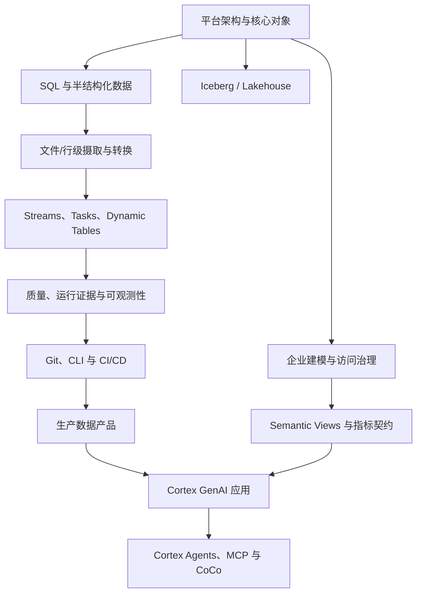

# Snowflake 独立课程 Roadmap：8 门 Coursera 课程 × 官方文档

**研究与整理日期：2026-10-19**  
**课程边界：** 本路线属于独立的 `courseId=snowflake` 学习体系。Cortex GenAI、Cortex Agents、Snowflake ML 和 CoCo 是 Snowflake 平台能力的学习分支，不因此归入仓库 AI 基础课程。

## 1. 来源与核实口径

以 [Snowflake Northstar 讲师主页](https://www.coursera.org/instructor/~155311909) 为课程发现入口，并单独核对第八门 [Snowflake CoCo Essentials](https://www.coursera.org/learn/coco-essentials)。讲师页公开展示的课程列表当时包含以下前七门；CoCo Essentials 独立课程页显示同一讲师并包含模块介绍。课程页会更新，后续维护应重新核对其 Modules 页面。

课程模块的公开标题与学习目标用于组织教学先后顺序；它们不是 Snowflake 产品行为的权威来源。每个技术结论应进一步由 Snowflake 官方文档核对。本仓库不抓取或复制付费视频逐字稿，也不假装访问了未公开的实验说明。

## 2. 八门课程与教学模块映射

### 1. Intro to Snowflake for Devs, Data Scientists, Data Engineers

课程：[Coursera 页面](https://www.coursera.org/learn/snowflake-intro-app-developers-data-scientists-data-engineers)

公开学习脉络从核心对象与架构开始，逐步扩展到进阶对象（如 Time Travel、克隆、UDF/存储过程），再触及数据工程、GenAI、ML 与应用开发。

对应本仓库知识点：核心对象与会话执行边界、半结构化数据、Time Travel/克隆、对象访问治理。它是主干课程的起点，不要求先完成仓库里的 AI 学习体系。

### 2. Introduction to Modern Data Engineering with Snowflake

课程：[Coursera 页面](https://www.coursera.org/learn/data-engineering-snowflake)

围绕 Ingestion–Transformation–Delivery（ITD）组织现代数据工程，覆盖数据摄取、SQL/Snowpark 转换、数据产品交付，以及 Tasks/DAG 式编排。

对应知识点：COPY INTO 与 Snowpipe、Snowpipe Streaming、SQL/Snowpark/UDF、数据产品交付、端到端数据管道。

### 3. Advanced Data Engineering with Snowflake

课程：[Coursera 页面](https://www.coursera.org/learn/advanced-data-engineering-with-snowflake)

课程重点是 DevOps 与 Observability：Git/协作、声明式对象变更、Snowflake CLI、CI/CD、环境晋级；以及 Events、Logs、Traces、Alerts 和 Notifications 等生产运行能力。

对应知识点：Git/CLI/CI-CD、声明式变更管理、管道可观测性、Warehouse/Query Profile 根因分析。

### 4. Apache Iceberg: From Zero to Production Data Lakehouse

课程：[Coursera 页面](https://www.coursera.org/learn/apache-iceberg-data-lakehouse)

路线从 Iceberg 基础进入迁移和 Schema/Partition Evolution，再进入生产运维，包括快照、文件压缩、并发写入和性能优化。

对应知识点：开放表格式与 Catalog、Schema/Partition Evolution、快照/Compaction/并发维护。重点是开放互操作与治理/运行责任之间的权衡，而不是只记忆 Iceberg 名词。

### 5. Introduction to Generative AI with Snowflake

课程：[Coursera 页面](https://www.coursera.org/learn/intro-generative-ai-course-snowflake)

公开课程结构涉及 GenAI 基础、Cortex LLM 函数、任务与模型选择、成本控制、微调及应用构建。

对应知识点：Cortex LLM 函数、文档解析/结构化抽取、模型评测和微调适用边界。这里学习的是 Snowflake 平台里的 AI 能力及其工程边界，不是 AI 基础课程的替代品。

### 6. Building Generative AI Apps to Talk to Your Data

课程：[Coursera 页面](https://www.coursera.org/learn/building-generative-ai-apps-to-talk-to-your-data)

围绕企业数据问答，涵盖结构化/非结构化数据、RAG/Hybrid Search、Text-to-SQL、语义模型/Cortex Analyst 与应用交付。

对应知识点：Cortex Search、Semantic View、Cortex Analyst、黄金查询、指标口径和连接基数验证。

### 7. Building AI Agents with Snowflake

课程：[Coursera 页面](https://www.coursera.org/learn/building-ai-agents-with-snowflake)

公开主题包含 Agent 与 Assistant 的区别、组合 Cortex Analyst/Search 工具、Orchestration Instructions、监控及 MCP 集成。

对应知识点：Agent 工具设计与编排、执行证据/评测、MCP 最小权限与审计。此处的 Agent 是 Snowflake 平台应用主题，仍属于 Snowflake 课程。

### 8. Snowflake CoCo Essentials

课程：[Coursera 页面](https://www.coursera.org/learn/coco-essentials)

该课页面给出的模块依次为：Introducing Snowflake CoCo、Setting Up Your Lab Environment、Data Exploration、Understanding and Modifying Code、Building with Snowflake CoCo、Knowledge Assessment。主要训练用 CoCo 探索数据、理解/修改/调试代码，并构建数据管道和应用。

对应知识点：CoCo 辅助数据探索、SQL/代码解释、调试与优化。生成建议必须经过人工审查、权限核验、执行计划分析和结果对账；更快并不等于语义正确。

## 3. 八个课程主题（知识骨架）

以下是本仓库自己的课程分类，不是 Coursera 课程的机械复制。每个主题通过 KnowledgeNode 与题目绑定；题目 `category` 用于主题筛选，`topic` 指向具体知识节点 ID。

| 主题 ID | 学习范围 | 主要知识点 ID 示例 |
| --- | --- | --- |
| `snowflake` | 平台架构、对象模型、半结构化数据、Time Travel/Clone | `snowflake-architecture`、`snowflake-core-objects`、`semi-structured-data`、`time-travel-cloning` |
| `data-architecture` | 分层、事实粒度、历史、语义层和访问控制 | `enterprise-data-zones`、`dimensional-modeling`、`semantic-metric-governance`、`object-access-governance` |
| `data-engineering` | 文件/行级摄取、SQL/Snowpark、CDC 与转换 | `snowflake-data-loading`、`snowpipe-file-ingestion`、`snowpipe-streaming`、`snowpark-udf-procedures` |
| `snowflake-lakehouse` | Iceberg 元数据、演进、快照和并发 | `iceberg-open-table-format`、`iceberg-schema-partition-evolution`、`iceberg-maintenance-concurrency` |
| `snowflake-devops` | Git/CLI、部署、变更管理、Trace/Logs/Alerts | `snowflake-git-cli-cicd`、`snowflake-declarative-change-management`、`snowflake-pipeline-observability` |
| `snowflake-data-products` | 数据共享、Marketplace、Streamlit/Native Apps、消费契约 | `snowflake-data-products` |
| `snowflake-genai` | Cortex 函数、文档抽取、Search、Analyst 和语义指标 | `cortex-llm-functions`、`cortex-document-functions`、`cortex-search-rag`、`cortex-analyst-semantic-sql` |
| `snowflake-agent-ml` | Cortex Agents、工具编排、MCP、评测、微调和 CoCo | `cortex-agent-orchestration`、`cortex-agent-observability-mcp`、`snowflake-model-finetuning`、`snowflake-coco-assisted-development` |

## 4. 学习依赖路线

这是一条可选择分支的 roadmap，不要求所有人逐课按直线学习。主干优先完成平台/数据工程/治理；Iceberg 是 Lakehouse 专题；Cortex/Agent/CoCo 是面向数据应用的进阶分支。

## 5. 官方文档目录（产品行为的权威核对入口）

### 平台与访问治理

- [Key concepts and architecture](https://docs.snowflake.com/en/user-guide/intro-key-concepts) — `docs-snowflake-architecture`
- [Virtual warehouses](https://docs.snowflake.com/en/user-guide/warehouses) — `docs-warehouses`
- [Time Travel](https://docs.snowflake.com/en/user-guide/data-time-travel) — `docs-time-travel`
- [Access control overview](https://docs.snowflake.com/en/user-guide/security-access-control-overview) — `docs-access-control`
- [Cost controls for warehouses](https://docs.snowflake.com/en/user-guide/cost-controlling-controls)

### 摄取、转换与运行

- [Data loading overview](https://docs.snowflake.com/en/user-guide/data-load-overview) — `docs-data-loading`
- [Snowpipe](https://docs.snowflake.com/en/user-guide/data-load-snowpipe-intro) — `docs-snowpipe`
- [Snowpipe Streaming](https://docs.snowflake.com/en/user-guide/snowpipe-streaming/data-load-snowpipe-streaming-overview) — `docs-snowpipe-streaming`
- [Streams and tasks](https://docs.snowflake.com/en/user-guide/data-pipelines-intro) — `docs-streams-tasks`
- [Dynamic tables](https://docs.snowflake.com/en/user-guide/dynamic-tables/overview) — `docs-dynamic-tables`
- [Dynamic tables decision guide](https://docs.snowflake.com/en/user-guide/dynamic-tables/decision-guide) — `docs-dynamic-tables-decision`
- [Query Profile](https://docs.snowflake.com/en/user-guide/ui-query-profile) — `docs-query-profile`
- [Snowflake CLI](https://docs.snowflake.com/en/developer-guide/snowflake-cli/index) — `docs-cli`

### Iceberg 与语义治理

- [Apache Iceberg tables](https://docs.snowflake.com/en/user-guide/tables-iceberg) — `docs-iceberg`
- [Manage Iceberg tables](https://docs.snowflake.com/en/user-guide/tables-iceberg-manage) — `docs-iceberg-maintenance`
- [Creating semantic views](https://docs.snowflake.com/en/user-guide/views-semantic/creating) — `docs-semantic-views`

### Cortex GenAI 与 Agents

- [Cortex AI functions](https://docs.snowflake.com/en/user-guide/snowflake-cortex/llm-functions) — `docs-cortex-functions`
- [Cortex Search](https://docs.snowflake.com/en/user-guide/snowflake-cortex/cortex-search/cortex-search-overview) — `docs-cortex-search`
- [Cortex Analyst](https://docs.snowflake.com/en/user-guide/snowflake-cortex/cortex-analyst) — `docs-cortex-analyst`
- [Cortex Agents](https://docs.snowflake.com/en/user-guide/snowflake-cortex/cortex-agents) — `docs-cortex-agents`
- [Snowflake documentation search for CoCo](https://docs.snowflake.com/en/search?q=CoCo) — `docs-coco`

## 6. 端到端实践与结业验收

**案例 A：混合数据接入。** 每日文件采用 COPY INTO，持续文件或行事件按延迟和成本评估 Snowpipe/Snowpipe Streaming；进入 Raw 后做结构校验、稳定业务键去重、质量隔离、批次追踪和源目标金额/笔数对账。

**案例 B：治理后的数据产品。** 构建 Conformed/Curated 层，以 Semantic View 明确指标定义、粒度和关系，通过角色权限、动态脱敏和行访问策略控制消费者访问；用黄金查询验证报表与自然语言问答的一致性。

**案例 C：发布与故障演练。** 把 SQL/DDL 放进 Git，通过专用身份、测试环境、CLI/CI 部署与上线验证；注入坏文件、schema 漂移、任务失败、迟到数据和重复事件，记录执行 Trace、恢复时间与账务对账结果。

**案例 D：Iceberg 迁移。** 选择 Catalog 与存储责任模型，用 Write-Audit-Publish 或等价隔离方案验证迁移前后数据与查询，然后测试 Schema/Partition Evolution、Compaction、快照保留、回滚和并发写入冲突。

**案例 E：企业数据问答/Agent。** 先验证 Semantic View 和黄金查询，再分别设计 Cortex Analyst（结构化指标）与 Cortex Search（非结构化资料）；最后组合 Agent 工具，测试工具权限、groundedness、Trace、失败处理和费用。CoCo 加快编码但不取代审查和结果等价验证。

结业标准：能够说明平台对象和执行模型；选择合适的摄取/转换路径；设计有幂等、对账、回补和可观测性的数据管道；维护语义和访问契约；通过可重复交付发布生产数据产品；能在 Iceberg 或 Cortex 专题中基于证据解释技术权衡。

## 7. 题库溯源约定

新题的 `source.materialId` 记录主教学课程，`source.section` 保存对应模块/章节；`source.relatedMaterials` 链接交叉核对的 Snowflake 官方文档 ID。Roadmap 中的 ID 对照关系是这些字段的目录。题目内容应做技术归纳，不应复制课程讲稿。

## 8. 新增 300 道课程来源可追溯题（2026-10-19）

本次在原有 39 个 Snowflake 知识节点与 41 道题基础上，新增 21 个细分知识节点，并为 60 个知识节点各补 5 道题，共新增 300 道题；因此 Snowflake 当前题库为 **60 个知识节点、341 道题**（41 道存量 + 300 道新增）。

题量按 8 门 Coursera 课程分配：平台基础 40 道、现代数据工程 45 道、Advanced Data Engineering 40 道、Iceberg 35 道、Generative AI 入门 35 道、Generative AI Apps 40 道、Agents 35 道、CoCo 30 道。每道题都记录 `source.materialId`、`source.section` 和官方文档 `source.relatedMaterials`。

- 新增知识节点：`src/data/knowledge/snowflake-roadmap-expansion.json`
- 新增题目：`src/data/questions/snowflake-roadmap-300.json`
- 逐题来源、模块、Knowledge ID 和 Question ID 映射：[snowflake-question-coverage-300.md](./snowflake-question-coverage-300.md)

本次静态预检验证 300 道题 ID 唯一、题干无重复、每个节点恰有 5 道新题、选项/答案/误解映射长度一致、所有课程与文档来源 ID 均可解析。未运行 TypeScript、Vitest、题库 CLI 门禁或构建，因此不代表运行时 schema、全库去重或 CI 已通过。
