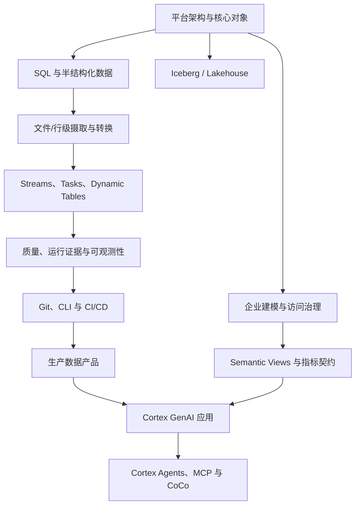

# Snowflake 独立课程 Roadmap：8 门 Coursera 课程 × 官方文档

**研究与整理日期：2026-10-19**  
**课程边界：** 本路线属于独立的 `courseId=snowflake` 学习体系。Cortex GenAI、Cortex Agents、Snowflake ML 和 CoCo 是 Snowflake 平台能力的学习分支，不因此归入仓库 AI 基础课程。

## 1. 来源与核实口径

以 [Snowflake Northstar 讲师主页](https://www.coursera.org/instructor/~155311909) 为课程发现入口，并单独核对第八门 [Snowflake CoCo Essentials](https://www.coursera.org/learn/coco-essentials)。讲师页公开展示的课程列表当时包含以下前七门；CoCo Essentials 独立课程页显示同一讲师并包含模块介绍。课程页会更新，后续维护应重新核对其 Modules 页面。

课程模块的公开标题与学习目标用于组织教学先后顺序；它们不是 Snowflake 产品行为的权威来源。每个技术结论应进一步由 Snowflake 官方文档核对。本仓库不抓取或复制付费视频逐字稿，也不假装访问了未公开的实验说明。

## 2. 八门课程与教学模块映射

### 1. Intro to Snowflake for Devs, Data Scientists, Data Engineers

课程：[Coursera 页面](https://www.coursera.org/learn/snowflake-intro-app-developers-data-scientists-data-engineers)

公开学习脉络从核心对象与架构开始，逐步扩展到进阶对象（如 Time Travel、克隆、UDF/存储过程），再触及数据工程、GenAI、ML 与应用开发。

对应本仓库知识点：核心对象与会话执行边界、半结构化数据、Time Travel/克隆、对象访问治理。它是主干课程的起点，不要求先完成仓库里的 AI 学习体系。

### 2. Introduction to Modern Data Engineering with Snowflake

课程：[Coursera 页面](https://www.coursera.org/learn/data-engineering-snowflake)

围绕 Ingestion–Transformation–Delivery（ITD）组织现代数据工程，覆盖数据摄取、SQL/Snowpark 转换、数据产品交付，以及 Tasks/DAG 式编排。

对应知识点：COPY INTO 与 Snowpipe、Snowpipe Streaming、SQL/Snowpark/UDF、数据产品交付、端到端数据管道。

### 3. Advanced Data Engineering with Snowflake

课程：[Coursera 页面](https://www.coursera.org/learn/advanced-data-engineering-with-snowflake)

课程重点是 DevOps 与 Observability：Git/协作、声明式对象变更、Snowflake CLI、CI/CD、环境晋级；以及 Events、Logs、Traces、Alerts 和 Notifications 等生产运行能力。

对应知识点：Git/CLI/CI-CD、声明式变更管理、管道可观测性、Warehouse/Query Profile 根因分析。

### 4. Apache Iceberg: From Zero to Production Data Lakehouse

课程：[Coursera 页面](https://www.coursera.org/learn/apache-iceberg-data-lakehouse)

路线从 Iceberg 基础进入迁移和 Schema/Partition Evolution，再进入生产运维，包括快照、文件压缩、并发写入和性能优化。

对应知识点：开放表格式与 Catalog、Schema/Partition Evolution、快照/Compaction/并发维护。重点是开放互操作与治理/运行责任之间的权衡，而不是只记忆 Iceberg 名词。

### 5. Introduction to Generative AI with Snowflake

课程：[Coursera 页面](https://www.coursera.org/learn/intro-generative-ai-course-snowflake)

公开课程结构涉及 GenAI 基础、Cortex LLM 函数、任务与模型选择、成本控制、微调及应用构建。

对应知识点：Cortex LLM 函数、文档解析/结构化抽取、模型评测和微调适用边界。这里学习的是 Snowflake 平台里的 AI 能力及其工程边界，不是 AI 基础课程的替代品。

### 6. Building Generative AI Apps to Talk to Your Data

课程：[Coursera 页面](https://www.coursera.org/learn/building-generative-ai-apps-to-talk-to-your-data)

围绕企业数据问答，涵盖结构化/非结构化数据、RAG/Hybrid Search、Text-to-SQL、语义模型/Cortex Analyst 与应用交付。

对应知识点：Cortex Search、Semantic View、Cortex Analyst、黄金查询、指标口径和连接基数验证。

### 7. Building AI Agents with Snowflake

课程：[Coursera 页面](https://www.coursera.org/learn/building-ai-agents-with-snowflake)

公开主题包含 Agent 与 Assistant 的区别、组合 Cortex Analyst/Search 工具、Orchestration Instructions、监控及 MCP 集成。

对应知识点：Agent 工具设计与编排、执行证据/评测、MCP 最小权限与审计。此处的 Agent 是 Snowflake 平台应用主题，仍属于 Snowflake 课程。

### 8. Snowflake CoCo Essentials

课程：[Coursera 页面](https://www.coursera.org/learn/coco-essentials)

该课页面给出的模块依次为：Introducing Snowflake CoCo、Setting Up Your Lab Environment、Data Exploration、Understanding and Modifying Code、Building with Snowflake CoCo、Knowledge Assessment。主要训练用 CoCo 探索数据、理解/修改/调试代码，并构建数据管道和应用。

对应知识点：CoCo 辅助数据探索、SQL/代码解释、调试与优化。生成建议必须经过人工审查、权限核验、执行计划分析和结果对账；更快并不等于语义正确。

## 3. 八个课程主题（知识骨架）

以下是本仓库自己的课程分类，不是 Coursera 课程的机械复制。每个主题通过 KnowledgeNode 与题目绑定；题目 `category` 用于主题筛选，`topic` 指向具体知识节点 ID。

| 主题 ID | 学习范围 | 主要知识点 ID 示例 |
| --- | --- | --- |
| `snowflake` | 平台架构、对象模型、半结构化数据、Time Travel/Clone | `snowflake-architecture`、`snowflake-core-objects`、`semi-structured-data`、`time-travel-cloning` |
| `data-architecture` | 分层、事实粒度、历史、语义层和访问控制 | `enterprise-data-zones`、`dimensional-modeling`、`semantic-metric-governance`、`object-access-governance` |
| `data-engineering` | 文件/行级摄取、SQL/Snowpark、CDC 与转换 | `snowflake-data-loading`、`snowpipe-file-ingestion`、`snowpipe-streaming`、`snowpark-udf-procedures` |
| `snowflake-lakehouse` | Iceberg 元数据、演进、快照和并发 | `iceberg-open-table-format`、`iceberg-schema-partition-evolution`、`iceberg-maintenance-concurrency` |
| `snowflake-devops` | Git/CLI、部署、变更管理、Trace/Logs/Alerts | `snowflake-git-cli-cicd`、`snowflake-declarative-change-management`、`snowflake-pipeline-observability` |
| `snowflake-data-products` | 数据共享、Marketplace、Streamlit/Native Apps、消费契约 | `snowflake-data-products` |
| `snowflake-genai` | Cortex 函数、文档抽取、Search、Analyst 和语义指标 | `cortex-llm-functions`、`cortex-document-functions`、`cortex-search-rag`、`cortex-analyst-semantic-sql` |
| `snowflake-agent-ml` | Cortex Agents、工具编排、MCP、评测、微调和 CoCo | `cortex-agent-orchestration`、`cortex-agent-observability-mcp`、`snowflake-model-finetuning`、`snowflake-coco-assisted-development` |

## 4. 学习依赖路线

这是一条可选择分支的 roadmap，不要求所有人逐课按直线学习。主干优先完成平台/数据工程/治理；Iceberg 是 Lakehouse 专题；Cortex/Agent/CoCo 是面向数据应用的进阶分支。

## 5. 官方文档目录（产品行为的权威核对入口）

### 平台与访问治理

- [Key concepts and architecture](https://docs.snowflake.com/en/user-guide/intro-key-concepts) — `docs-snowflake-architecture`
- [Virtual warehouses](https://docs.snowflake.com/en/user-guide/warehouses) — `docs-warehouses`
- [Time Travel](https://docs.snowflake.com/en/user-guide/data-time-travel) — `docs-time-travel`
- [Access control overview](https://docs.snowflake.com/en/user-guide/security-access-control-overview) — `docs-access-control`
- [Cost controls for warehouses](https://docs.snowflake.com/en/user-guide/cost-controlling-controls)

### 摄取、转换与运行

- [Data loading overview](https://docs.snowflake.com/en/user-guide/data-load-overview) — `docs-data-loading`
- [Snowpipe](https://docs.snowflake.com/en/user-guide/data-load-snowpipe-intro) — `docs-snowpipe`
- [Snowpipe Streaming](https://docs.snowflake.com/en/user-guide/snowpipe-streaming/data-load-snowpipe-streaming-overview) — `docs-snowpipe-streaming`
- [Streams and tasks](https://docs.snowflake.com/en/user-guide/data-pipelines-intro) — `docs-streams-tasks`
- [Dynamic tables](https://docs.snowflake.com/en/user-guide/dynamic-tables/overview) — `docs-dynamic-tables`
- [Dynamic tables decision guide](https://docs.snowflake.com/en/user-guide/dynamic-tables/decision-guide) — `docs-dynamic-tables-decision`
- [Query Profile](https://docs.snowflake.com/en/user-guide/ui-query-profile) — `docs-query-profile`
- [Snowflake CLI](https://docs.snowflake.com/en/developer-guide/snowflake-cli/index) — `docs-cli`

### Iceberg 与语义治理

- [Apache Iceberg tables](https://docs.snowflake.com/en/user-guide/tables-iceberg) — `docs-iceberg`
- [Manage Iceberg tables](https://docs.snowflake.com/en/user-guide/tables-iceberg-manage) — `docs-iceberg-maintenance`
- [Creating semantic views](https://docs.snowflake.com/en/user-guide/views-semantic/creating) — `docs-semantic-views`

### Cortex GenAI 与 Agents

- [Cortex AI functions](https://docs.snowflake.com/en/user-guide/snowflake-cortex/llm-functions) — `docs-cortex-functions`
- [Cortex Search](https://docs.snowflake.com/en/user-guide/snowflake-cortex/cortex-search/cortex-search-overview) — `docs-cortex-search`
- [Cortex Analyst](https://docs.snowflake.com/en/user-guide/snowflake-cortex/cortex-analyst) — `docs-cortex-analyst`
- [Cortex Agents](https://docs.snowflake.com/en/user-guide/snowflake-cortex/cortex-agents) — `docs-cortex-agents`
- [Snowflake documentation search for CoCo](https://docs.snowflake.com/en/search?q=CoCo) — `docs-coco`

## 6. 端到端实践与结业验收

**案例 A：混合数据接入。** 每日文件采用 COPY INTO，持续文件或行事件按延迟和成本评估 Snowpipe/Snowpipe Streaming；进入 Raw 后做结构校验、稳定业务键去重、质量隔离、批次追踪和源目标金额/笔数对账。

**案例 B：治理后的数据产品。** 构建 Conformed/Curated 层，以 Semantic View 明确指标定义、粒度和关系，通过角色权限、动态脱敏和行访问策略控制消费者访问；用黄金查询验证报表与自然语言问答的一致性。

**案例 C：发布与故障演练。** 把 SQL/DDL 放进 Git，通过专用身份、测试环境、CLI/CI 部署与上线验证；注入坏文件、schema 漂移、任务失败、迟到数据和重复事件，记录执行 Trace、恢复时间与账务对账结果。

**案例 D：Iceberg 迁移。** 选择 Catalog 与存储责任模型，用 Write-Audit-Publish 或等价隔离方案验证迁移前后数据与查询，然后测试 Schema/Partition Evolution、Compaction、快照保留、回滚和并发写入冲突。

**案例 E：企业数据问答/Agent。** 先验证 Semantic View 和黄金查询，再分别设计 Cortex Analyst（结构化指标）与 Cortex Search（非结构化资料）；最后组合 Agent 工具，测试工具权限、groundedness、Trace、失败处理和费用。CoCo 加快编码但不取代审查和结果等价验证。

结业标准：能够说明平台对象和执行模型；选择合适的摄取/转换路径；设计有幂等、对账、回补和可观测性的数据管道；维护语义和访问契约；通过可重复交付发布生产数据产品；能在 Iceberg 或 Cortex 专题中基于证据解释技术权衡。

## 7. 题库溯源约定

新题的 `source.materialId` 记录主教学课程，`source.section` 保存对应模块/章节；`source.relatedMaterials` 链接交叉核对的 Snowflake 官方文档 ID。Roadmap 中的 ID 对照关系是这些字段的目录。题目内容应做技术归纳，不应复制课程讲稿。

## 8. 新增 300 道课程来源可追溯题（2026-10-19）

本次在原有 39 个 Snowflake 知识节点与 41 道题基础上，新增 21 个细分知识节点，并为 60 个知识节点各补 5 道题，共新增 300 道题；因此 Snowflake 当前题库为 **60 个知识节点、341 道题**（41 道存量 + 300 道新增）。

题量按 8 门 Coursera 课程分配：平台基础 40 道、现代数据工程 45 道、Advanced Data Engineering 40 道、Iceberg 35 道、Generative AI 入门 35 道、Generative AI Apps 40 道、Agents 35 道、CoCo 30 道。每道题都记录 `source.materialId`、`source.section` 和官方文档 `source.relatedMaterials`。

- 新增知识节点：`src/data/knowledge/snowflake-roadmap-expansion.json`
- 新增题目：`src/data/questions/snowflake-roadmap-300.json`
- 逐题来源、模块、Knowledge ID 和 Question ID 映射：[snowflake-question-coverage-300.md](./snowflake-question-coverage-300.md)

本次静态预检验证 300 道题 ID 唯一、题干无重复、每个节点恰有 5 道新题、选项/答案/误解映射长度一致、所有课程与文档来源 ID 均可解析。未运行 TypeScript、Vitest、题库 CLI 门禁或构建，因此不代表运行时 schema、全库去重或 CI 已通过。

## 9. 简明题库补充（2026-10-19）

新增一批直白、以简单和中等为主的 200 道 Snowflake 题：120 道简单、80 道中等，不新增困难题。按 8 门 Coursera 课程均衡安排，每门覆盖 5 个知识点，每个点 5 道题。

新增 19 个知识点，同时为 21 个既有知识点增加基础题。本批题目独立存放：
- `src/data/knowledge/snowflake-simple-expansion.json`
- `src/data/questions/snowflake-simple-200.json`
- `docs/snowflake-question-coverage-200.md`

新增后 Snowflake 题库累计 541 道（原有 41 + 前一批 300 + 本批 200），知识点 79 个（原有 39 + 前一批新增 21 + 本批新增 19）。本次仅做生成后静态检查，尚未运行 schema、CLI 门禁、测试或构建。

## 10. SnowPro Core COF-C03 考点补充（2026-10-19）

参考 [Snowflake 官方 COF-C03 考试指南](https://publish-p93462-e887935.adobeaemcloud.com/content/dam/snowpro-sg/SnowProCoreStudyGuideC03.pdf) 和公开的 [CertSafari Free Snowflake Practice Questions](https://www.certsafari.com/snowflake/snowpro-core-certification-c03/practice-questions) 的考试领域/知识点目录，新增加 200 道自编练习题，按官方五个 Domain 的权重分配为 62/40/36/42/20；难度为 120 道简单、80 道中等。

- 新增 18 个知识节点，累计 97 个 Snowflake 知识节点。
- Snowflake 累计题目 741 道（本批新增前 541 道 + 本批 200 道）。
- 本批题目、知识点与来源映射见 [SnowPro Core COF-C03 覆盖矩阵](./snowflake-certification-cof-c03-coverage-200.md)。
- CoCo 属于课程相关补充，不是官方 COF-C03 指南单独列明的产品考点；请勿将课程覆盖等同于考试保证。

本批只完成静态数据预检，未运行 TypeScript、Vitest、题库 CLI 门禁、全库重复检查或构建。

## 11. Snowflake Developer Guides 实战与架构扩展（2026-10-19）

基于 [Snowflake Developer Guides](https://www.snowflake.com/en/developers/guides/) 中已核对的 Quickstart、参考架构和 Well-Architected 指南，新增 **200 道原创题**（120 道简单、80 道中等）和 **20 个知识点**，每个知识点 10 道题；选择题采用 140 道双答案多选（70%）和 60 道单选（30%），满足新题导入的多选比例要求。重点考察生产工程边界，不将演示案例写成通用 SLA 保证。

- 题目：[snowflake-developer-guides-200.json](../src/data/questions/snowflake-developer-guides-200.json)
- 知识点：[snowflake-developer-guides-expansion.json](../src/data/knowledge/snowflake-developer-guides-expansion.json)
- 覆盖矩阵：[snowflake-developer-guides-coverage-200.md](./snowflake-developer-guides-coverage-200.md)

### 本批使用的官方 Guide ID

- [Getting Started with Data Engineering using Snowflake Notebooks](https://www.snowflake.com/en/developers/guides/data-engineering-with-notebooks/) — `guide-snowflake-data-engineering-notebooks`
- [Build a Real-Time BI Dashboard with Interactive Warehouses](https://www.snowflake.com/en/developers/guides/build-real-time-bi-dashboard-interactive-warehouses/) — `guide-snowflake-real-time-bi`
- [Well-Architected Framework: Performance](https://www.snowflake.com/en/developers/guides/performance/) — `guide-snowflake-performance`
- [Well-Architected Framework: Cost Optimization and FinOps](https://www.snowflake.com/en/developers/guides/well-architected-framework-cost-optimization-and-finops/) — `guide-snowflake-cost-optimization`
- [Well-Architected Framework: Security and Governance](https://www.snowflake.com/en/developers/guides/security-and-governance/) — `guide-snowflake-security-governance`
- [Well-Architected Framework: Reliability](https://www.snowflake.com/en/developers/guides/well-architected-framework-reliability/) — `guide-snowflake-reliability`
- [Well-Architected Framework: Operational Excellence](https://www.snowflake.com/en/developers/guides/operational-excellence/) — `guide-snowflake-operational-excellence`
- [Build an Eval-Gated CI/CD Pipeline for Snowflake Semantic Views](https://www.snowflake.com/en/developers/guides/semantic-view-eval-cicd/) — `guide-snowflake-semantic-view-eval-cicd`
- [Get Started with Snowflake DCM Projects](https://www.snowflake.com/en/developers/guides/get-started-snowflake-dcm-projects/) — `guide-snowflake-dcm-projects`
- [Call the Cortex Agents API from Streamlit on the Container Runtime](https://www.snowflake.com/en/developers/guides/getting-started-with-cortex-agents-api-and-streamlit-on-container-runtime/) — `guide-snowflake-agent-streamlit-container`
- [Getting Started with Snowflake Native Apps](https://www.snowflake.com/en/developers/guides/getting-started-with-native-apps/) — `guide-snowflake-native-apps`
- [Building a Pipeline Auditor with the Cortex Agent SDK](https://www.snowflake.com/en/developers/guides/pipeline-auditor-with-cortex-agent-sdk/) — `guide-snowflake-pipeline-auditor`
- [Build an End-to-End Application Using CoCo on Snowflake](https://www.snowflake.com/en/developers/guides/sfguide-build-end-to-end-ai-app-on-snowflake/) — `guide-snowflake-end-to-end-coco-ai-app`
- [About Streamlit in Snowflake](https://docs.snowflake.com/en/developer-guide/streamlit/about-streamlit) — `docs-snowflake-streamlit-runtime`
- [Add a Streamlit app to a Snowflake Native App](https://docs.snowflake.com/en/developer-guide/native-apps/adding-streamlit) — `docs-snowflake-native-app-streamlit`
- [Network policies](https://docs.snowflake.com/en/user-guide/network-policies) — `docs-network-policy`
- [Query history](https://docs.snowflake.com/en/user-guide/ui-query-history) — `docs-query-history`

截至 2026-10-20 本批完成时，Snowflake 题目累计 **941 道**，知识节点累计 **117 个**；后续新增批次见后续章节。本批完成静态预检；未运行 TypeScript、Vitest、题库 CLI 门禁、完整全库去重或 build。

## 12. Snowflake CoCo Skills 专项扩展（2026-10-20）

基于 [Snowflake-Labs/coco-skills](https://github.com/Snowflake-Labs/coco-skills) 的技能工作流和示例，新增 100 道简单/中等题与 10 个知识点。重点从技能文档中提炼可迁移的工程判断，而不是记忆命令名称或照搬单个演示的配置。

- 题目：[`snowflake-coco-skills-100.json`](../src/data/questions/snowflake-coco-skills-100.json)
- 知识点：[`snowflake-coco-skills-expansion.json`](../src/data/knowledge/snowflake-coco-skills-expansion.json)
- 覆盖矩阵：[`snowflake-coco-skills-100.md`](./snowflake-coco-skills-100.md)

本批包含 60 道简单题、40 道中等题；68 道多选（每题恰好两个正确项）与 32 道单选。十个知识主题涵盖 Semantic View 高级建模、Cortex Analyst 问数应用、Ontology 分层、Dynamic Tables 选型、dbt 自动建模、RBAC、Snowpipe BCDR、OpenFlow PrivateLink、SAP BDC Zero-Copy Connector，以及 Cortex 模型可用性和 CoCo Skill 执行边界。

特别注意：Cortex base mode 与 agentic mode 独立；目标账户/区域中的真实探测比静态名称清单更可靠。Dynamic Tables 的 TARGET_LAG 是新鲜度目标，不是无条件 SLA；语义视图的部署/解释 SQL 也不能替代数据结果验证。更多逐题来源与官方文档入口见覆盖矩阵。

## 13. PostgreSQL 全日培训主题向 Snowflake 的适配来源

新增题集引用的主教学来源为 [Snowflake-Labs/postgres-full-day-training](https://github.com/Snowflake-Labs/postgres-full-day-training)，其原始内容是 PostgreSQL 实战训练。这里只借用公开的课程主题和学习目标；Snowflake 题目中的产品行为、限制、优化建议必须以以下 Snowflake 官方文档为准，不能把 PostgreSQL 命令和存储机制直接移植到 Snowflake。

- [SQL query syntax](https://docs.snowflake.com/en/sql-reference/constructs) — `docs-sql-query-constructs`
- [Transactions](https://docs.snowflake.com/en/sql-reference/transactions) — `docs-sql-transactions`
- [Window functions](https://docs.snowflake.com/en/user-guide/functions-window-using) — `docs-sql-window-functions`
- [WITH / CTE](https://docs.snowflake.com/en/sql-reference/constructs/with) — `docs-sql-ctes`
- [Querying semi-structured data](https://docs.snowflake.com/en/user-guide/querying-semistructured) — `docs-semi-structured-query`
- [FLATTEN](https://docs.snowflake.com/en/sql-reference/functions/flatten) — `docs-flatten`
- [MERGE](https://docs.snowflake.com/en/sql-reference/sql/merge) — `docs-sql-merge`
- [QUERY_HISTORY Account Usage view](https://docs.snowflake.com/en/sql-reference/account-usage/query_history) — `docs-query-history-sql-view`
- [Cloning considerations](https://docs.snowflake.com/en/user-guide/object-clone) — `docs-snowflake-cloning`
- [Exploring query execution times](https://docs.snowflake.com/en/user-guide/performance-query-exploring) — `docs-performance-query-exploring`
- [Optimizing query performance](https://docs.snowflake.com/en/user-guide/performance-query-options) — `docs-performance-query-options`
- [Cost controls for warehouses](https://docs.snowflake.com/en/user-guide/cost-controlling-controls) — `docs-cost-controls`
- [Optimizing the warehouse cache](https://docs.snowflake.com/en/user-guide/performance-query-warehouse-cache) — `docs-warehouse-cache`
- [Persisted query results](https://docs.snowflake.com/en/user-guide/querying-persisted-results) — `docs-persisted-query-results`
- [Micro-partitions and data clustering](https://docs.snowflake.com/en/user-guide/tables-clustering-micropartitions) — `docs-micro-partitions`
- [Clustering keys](https://docs.snowflake.com/en/user-guide/tables-clustering-keys) — `docs-clustering-keys`
- [Search optimization service](https://docs.snowflake.com/en/user-guide/search-optimization-service) — `docs-search-optimization`
- [Network policies](https://docs.snowflake.com/en/user-guide/network-policies) — `docs-network-policy`

特别注意：原培训中的 WAL / VACUUM / `shared_buffers` / `work_mem` / PostgreSQL 系统目录与传统索引属于 PostgreSQL 特定机制。本题集将相关学习目标改写为 Snowflake 的 Time Travel 与恢复窗口、Streams/Tasks/Dynamic Tables、Query History/Profile、Warehouse 并发和资源治理、微分区裁剪及适用的优化服务；不会声称两种数据库使用同一种底层实现。

## 14. PostgreSQL Full-Day Training 向 Snowflake 迁移练习（2026-10-23）

新增 7 个知识节点和 200 道原创题，课程主题参考 PostgreSQL 全日培训，题目行为根据 Snowflake 官方文档重新核对，不混用两种数据库的实现机制。

- 题集：`src/data/questions/snowflake-postgres-full-day-200-a.json`、`snowflake-postgres-full-day-200-b.json`、`snowflake-postgres-full-day-200-c.json`
- 知识节点：`src/data/knowledge/snowflake-postgres-full-day.json`
- 逐题覆盖矩阵：[snowflake-postgres-full-day-200.md](./snowflake-postgres-full-day-200.md)
- 难度分布：100 easy、100 medium；题型分布：54 单选、146 多选。
- 本批完成后，Snowflake 题库累计 **1141 道**，知识节点累计 **124 个**。

已完成静态预检：题目编号与题干唯一、难度和题型统计符合预期、答案索引及误解映射有效、20 个知识主题引用可解析、所有交叉文档 ID 均已登记。未运行 TypeScript、Vitest、完整题库 CLI 校验或 build。

## 15. Snowflake course 下的 PostgreSQL 原生数据库工程模块（2026-10-23）

本节与第 13、14 节区分：第 13、14 节是将 PostgreSQL 培训主题改写为 Snowflake 语义；本节则**直接教授 PostgreSQL 自身**。题目通过 `courseId: "snowflake"` 加入现有 Snowflake 学习入口，但使用独立的 `postgresql` 主题标签、20 个 PostgreSQL 知识节点、独立来源映射与题目 ID。它不是 Snowflake 功能目录，学习时不能把 PostgreSQL 专属机制归因到 Snowflake。

- 题目文件：`src/data/questions/postgresql-module-200-a.json` 至 `postgresql-module-200-d.json`，编号 `sf-pg-001` 至 `sf-pg-200`
- 知识节点：`src/data/knowledge/postgresql-module.json`，20 个节点，每个节点各 10 道题
- 覆盖矩阵与参考资料：[PostgreSQL 原生数据库工程模块（200 题）](./postgresql-module-in-snowflake-course-200.md)
- 内容来自 [Snowflake-Labs/postgres-full-day-training](https://github.com/Snowflake-Labs/postgres-full-day-training) 的六小时课程安排与 SQL 练习；该训练仓库目标为 PostgreSQL 18，并说明与 PostgreSQL 14+ 的兼容范围。PostgreSQL 18 官方文档也提供版本化手册与每项机制的约束细节。

### 官方 PostgreSQL / 扩展文档 ID

- [PostgreSQL tutorial](https://www.postgresql.org/docs/18/tutorial.html) — `pg-doc-tutorial`
- [Installation / setup](https://www.postgresql.org/docs/18/installation.html) — `pg-doc-setup`
- [psql](https://www.postgresql.org/docs/18/app-psql.html) — `pg-doc-psql`
- [Schemas](https://www.postgresql.org/docs/18/ddl-schemas.html) — `pg-doc-ddl-schema`
- [Privileges](https://www.postgresql.org/docs/18/ddl-priv.html) — `pg-doc-privileges`
- [SQL commands](https://www.postgresql.org/docs/18/sql.html) — `pg-doc-sql`
- [Data types](https://www.postgresql.org/docs/18/datatype.html) — `pg-doc-data-types`
- [Constraints](https://www.postgresql.org/docs/18/ddl-constraints.html) — `pg-doc-constraints`
- [Data definition](https://www.postgresql.org/docs/18/ddl.html) — `pg-doc-ddl`
- [Client authentication](https://www.postgresql.org/docs/18/client-authentication.html) — `pg-doc-client-auth`
- [Database roles](https://www.postgresql.org/docs/18/user-manag.html) — `pg-doc-security`
- [Data manipulation](https://www.postgresql.org/docs/18/dml.html) — `pg-doc-dml`
- [Queries](https://www.postgresql.org/docs/18/queries.html) — `pg-doc-queries`
- [Table expressions and joins](https://www.postgresql.org/docs/18/queries-table-expressions.html) — `pg-doc-joins`
- [Aggregate functions](https://www.postgresql.org/docs/18/functions-aggregate.html) — `pg-doc-aggregates`
- [Arrays](https://www.postgresql.org/docs/18/arrays.html) — `pg-doc-arrays`
- [JSON functions](https://www.postgresql.org/docs/18/functions-json.html) — `pg-doc-json`
- [Indexes](https://www.postgresql.org/docs/18/indexes.html) — `pg-doc-indexes`
- [Window functions](https://www.postgresql.org/docs/18/functions-window.html) — `pg-doc-window`
- [PL/pgSQL](https://www.postgresql.org/docs/18/plpgsql.html) — `pg-doc-plpgsql`
- [Transactions tutorial](https://www.postgresql.org/docs/18/tutorial-transactions.html) — `pg-doc-transactions`
- [MVCC introduction](https://www.postgresql.org/docs/18/mvcc-intro.html) — `pg-doc-mvcc`
- [Transaction isolation](https://www.postgresql.org/docs/18/transaction-iso.html) — `pg-doc-isolation`
- [Explicit locking](https://www.postgresql.org/docs/18/explicit-locking.html) — `pg-doc-locks`
- [Monitoring statistics](https://www.postgresql.org/docs/18/monitoring-stats.html) — `pg-doc-monitoring`
- [Routine vacuuming](https://www.postgresql.org/docs/18/routine-vacuuming.html) — `pg-doc-vacuum`
- [WAL](https://www.postgresql.org/docs/18/wal.html) — `pg-doc-wal`
- [Backup and restore](https://www.postgresql.org/docs/18/backup.html) — `pg-doc-backup`
- [High availability](https://www.postgresql.org/docs/18/high-availability.html) — `pg-doc-ha`
- [Logical replication](https://www.postgresql.org/docs/18/logical-replication.html) — `pg-doc-logical-replication`
- [Connection settings](https://www.postgresql.org/docs/18/runtime-config-connection.html) — `pg-doc-connections`
- [PgBouncer configuration](https://www.pgbouncer.org/config.html) — `pg-doc-pgbouncer`
- [Table partitioning](https://www.postgresql.org/docs/18/ddl-partitioning.html) — `pg-doc-partitioning`
- [Logging configuration](https://www.postgresql.org/docs/18/runtime-config-logging.html) — `pg-doc-logging`
- [Server resource configuration](https://www.postgresql.org/docs/18/runtime-config-resource.html) — `pg-doc-config`
- [Parallel query](https://www.postgresql.org/docs/18/parallel-query.html) — `pg-doc-parallel`
- [Performance tips](https://www.postgresql.org/docs/18/performance-tips.html) — `pg-doc-performance`
- [EXPLAIN](https://www.postgresql.org/docs/18/sql-explain.html) — `pg-doc-explain`
- [Full-text search](https://www.postgresql.org/docs/18/textsearch.html) — `pg-doc-textsearch`
- [Extending PostgreSQL](https://www.postgresql.org/docs/18/extend.html) — `pg-doc-extensions`
- [PostGIS](https://postgis.net/documentation/) — `pg-doc-postgis`
- [pgvector](https://github.com/pgvector/pgvector) — `pg-doc-pgvector`

题目中的版本敏感表述应按版本标注。培训仓库以 PostgreSQL 18 为主，同时注明与 PostgreSQL 14+ 的兼容性；例如 `UNIQUE NULLS NOT DISTINCT` 自 PostgreSQL 15 起可用，并非 PostgreSQL 18 才新增。扩展（PgBouncer、PostGIS、pgvector）也需单独核对目标部署环境和版本。
