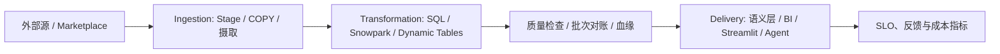
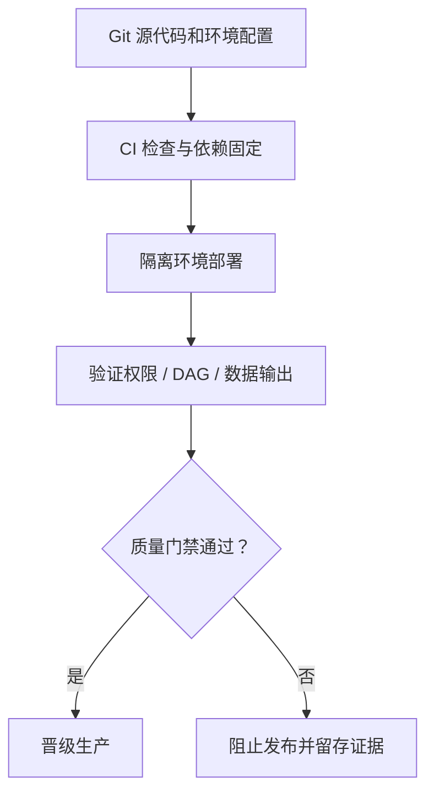
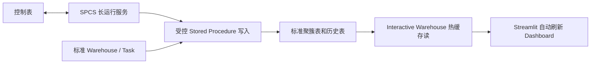
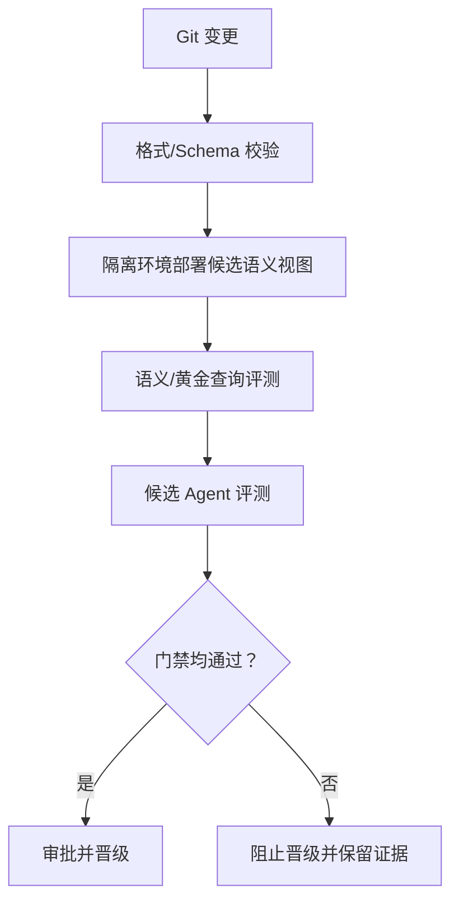

# Snowflake Developer Guides 实战与架构题覆盖矩阵

**研究日期：** 2026-10-19  
**发现入口：** [Snowflake Developer Guides](https://www.snowflake.com/en/developers/guides/)  
**范围：** 根据已核对的官方 Quickstart、参考架构和 Well-Architected 指南，新增 200 道原创题及 20 个知识点，归属独立 `courseId=snowflake`。

## 题量

| 难度 | 数量 |
|---|---:|
| 简单 | 120 |
| 中等 | 80 |
| 困难 | 0 |
| **合计** | **200** |

每个知识点覆盖 10 道题。每道题包括选择题、开放题参考答案、误解映射、主 Guide ID 与相关官方文档。选择题分布为 **140 道双答案多选（70%）和 60 道单选（30%）**，符合项目新题导入的多选题比例门禁。题目关注架构取舍、适用边界、诊断和生产验收，而不复制指南代码/题面。

## 题库门禁与静态检查

本批静态检查验证：题目 ID 和题干唯一；多选题恰有两个正确项；选择项不重复；答案索引和误解映射合法；选项长度比不超过 1.8；无占位符文本；所有知识点和来源 ID 均可解析。项目 TypeScript、Vitest、正式 CLI 导入门禁和 build 未运行，因此这里记录的是静态预检结果，不代表自动化测试已通过。

## 知识点与 Question ID

| Knowledge ID | 知识点 | Guide ID | Question ID 范围 | 题数 |
|---|---|---|---|---|
| `snowflake-guide-itd` | ITD 端到端数据管道 | `guide-snowflake-data-engineering-notebooks` | `sf-dev-guides-200-itd-01`–`sf-dev-guides-200-itd-10` | 10（6 简单 / 4 中等） |
| `snowflake-guide-notebooks` | Snowflake Notebooks 与 Snowpark 工程化 | `guide-snowflake-data-engineering-notebooks` | `sf-dev-guides-200-notebooks-01`–`sf-dev-guides-200-notebooks-10` | 10（6 简单 / 4 中等） |
| `snowflake-guide-task-dag` | Task DAG 与任务管理 API | `guide-snowflake-data-engineering-notebooks` | `sf-dev-guides-200-task-dag-01`–`sf-dev-guides-200-task-dag-10` | 10（6 简单 / 4 中等） |
| `snowflake-guide-dynamic-tables` | Dynamic Tables 与 Streams/Tasks 选型 | `guide-snowflake-end-to-end-coco-ai-app` | `sf-dev-guides-200-dynamic-tables-01`–`sf-dev-guides-200-dynamic-tables-10` | 10（6 简单 / 4 中等） |
| `snowflake-guide-cicd` | Snowflake CLI、Git 与 Notebook CI/CD | `guide-snowflake-data-engineering-notebooks` | `sf-dev-guides-200-cicd-01`–`sf-dev-guides-200-cicd-10` | 10（6 简单 / 4 中等） |
| `snowflake-guide-dcm` | DCM Projects 声明式变更管理 | `guide-snowflake-dcm-projects` | `sf-dev-guides-200-dcm-01`–`sf-dev-guides-200-dcm-10` | 10（6 简单 / 4 中等） |
| `snowflake-guide-streamlit-runtime` | Streamlit Warehouse Runtime 与 Container Runtime | `guide-snowflake-agent-streamlit-container` | `sf-dev-guides-200-streamlit-runtime-01`–`sf-dev-guides-200-streamlit-runtime-10` | 10（6 简单 / 4 中等） |
| `snowflake-guide-interactive-bi` | Interactive Warehouse 实时 BI 读写分离 | `guide-snowflake-real-time-bi` | `sf-dev-guides-200-interactive-bi-01`–`sf-dev-guides-200-interactive-bi-10` | 10（6 简单 / 4 中等） |
| `snowflake-guide-performance-slo` | 以 SLO 与基线驱动性能工程 | `guide-snowflake-performance` | `sf-dev-guides-200-performance-slo-01`–`sf-dev-guides-200-performance-slo-10` | 10（6 简单 / 4 中等） |
| `snowflake-guide-query-diagnostics` | Query Profile 与弹性计算取舍 | `guide-snowflake-performance` | `sf-dev-guides-200-query-diagnostics-01`–`sf-dev-guides-200-query-diagnostics-10` | 10（6 简单 / 4 中等） |
| `snowflake-guide-finops` | 成本归因、预算护栏与 FinOps 闭环 | `guide-snowflake-cost-optimization` | `sf-dev-guides-200-finops-01`–`sf-dev-guides-200-finops-10` | 10（6 简单 / 4 中等） |
| `snowflake-guide-security` | 网络边界、身份认证与外部数据通路 | `guide-snowflake-security-governance` | `sf-dev-guides-200-security-01`–`sf-dev-guides-200-security-10` | 10（6 简单 / 4 中等） |
| `snowflake-guide-least-privilege` | 最小权限角色与受控写入入口 | `guide-snowflake-real-time-bi` | `sf-dev-guides-200-least-privilege-01`–`sf-dev-guides-200-least-privilege-10` | 10（6 简单 / 4 中等） |
| `snowflake-guide-pipeline-auditor` | Pipeline Auditor 与结构化健康检查 | `guide-snowflake-pipeline-auditor` | `sf-dev-guides-200-pipeline-auditor-01`–`sf-dev-guides-200-pipeline-auditor-10` | 10（6 简单 / 4 中等） |
| `snowflake-guide-operations` | 运行准备度、告警与持续改进 | `guide-snowflake-operational-excellence` | `sf-dev-guides-200-operations-01`–`sf-dev-guides-200-operations-10` | 10（6 简单 / 4 中等） |
| `snowflake-guide-reliability` | 数据契约、Schema 漂移与幂等恢复 | `guide-snowflake-reliability` | `sf-dev-guides-200-reliability-01`–`sf-dev-guides-200-reliability-10` | 10（6 简单 / 4 中等） |
| `snowflake-guide-disaster-recovery` | 跨区域恢复与业务连续性 | `guide-snowflake-reliability` | `sf-dev-guides-200-disaster-recovery-01`–`sf-dev-guides-200-disaster-recovery-10` | 10（6 简单 / 4 中等） |
| `snowflake-guide-semantic-eval` | Semantic View 与 Cortex Agent 评测晋级门禁 | `guide-snowflake-semantic-view-eval-cicd` | `sf-dev-guides-200-semantic-eval-01`–`sf-dev-guides-200-semantic-eval-10` | 10（6 简单 / 4 中等） |
| `snowflake-guide-native-app` | Native App 安装、引用与消费者授权 | `guide-snowflake-native-apps` | `sf-dev-guides-200-native-app-01`–`sf-dev-guides-200-native-app-10` | 10（6 简单 / 4 中等） |
| `snowflake-guide-coco` | CoCo 辅助构建端到端数据与 AI 应用 | `guide-snowflake-end-to-end-coco-ai-app` | `sf-dev-guides-200-coco-01`–`sf-dev-guides-200-coco-10` | 10（6 简单 / 4 中等） |

## 关键架构模式

### ITD 端到端管道

### Notebook 与 Task DAG 交付

### Interactive Warehouse 实时 BI

这是官方 Quickstart 展示的特定工作负载方案，不是所有查询的通用 SLA。使用前应核实区域/账户支持，并在目标负载下验证读写、缓存、新鲜度与成本。

### Semantic View 与 Agent 评测门禁

语义正确性与 Agent 行为是不同的测试面。候选语义视图和 dashboard 应与生产隔离；保留旧 Agent 默认版本不自动回滚共享对象。

## 官方 Guide Catalog

| ID | 指南 | 链接 |
|---|---|---|
| `guide-snowflake-data-engineering-notebooks` | Data Engineering with Snowflake Notebooks | [打开](https://www.snowflake.com/en/developers/guides/data-engineering-with-notebooks/) |
| `guide-snowflake-real-time-bi` | Real-Time BI with Interactive Warehouses | [打开](https://www.snowflake.com/en/developers/guides/build-real-time-bi-dashboard-interactive-warehouses/) |
| `guide-snowflake-performance` | Well-Architected Performance | [打开](https://www.snowflake.com/en/developers/guides/performance/) |
| `guide-snowflake-cost-optimization` | Well-Architected Cost Optimization and FinOps | [打开](https://www.snowflake.com/en/developers/guides/well-architected-framework-cost-optimization-and-finops/) |
| `guide-snowflake-security-governance` | Well-Architected Security and Governance | [打开](https://www.snowflake.com/en/developers/guides/security-and-governance/) |
| `guide-snowflake-reliability` | Well-Architected Reliability | [打开](https://www.snowflake.com/en/developers/guides/well-architected-framework-reliability/) |
| `guide-snowflake-operational-excellence` | Well-Architected Operational Excellence | [打开](https://www.snowflake.com/en/developers/guides/operational-excellence/) |
| `guide-snowflake-semantic-view-eval-cicd` | Eval-Gated CI/CD for Semantic Views | [打开](https://www.snowflake.com/en/developers/guides/semantic-view-eval-cicd/) |
| `guide-snowflake-dcm-projects` | Snowflake DCM Projects | [打开](https://www.snowflake.com/en/developers/guides/get-started-snowflake-dcm-projects/) |
| `guide-snowflake-agent-streamlit-container` | Cortex Agents API from Streamlit Container Runtime | [打开](https://www.snowflake.com/en/developers/guides/getting-started-with-cortex-agents-api-and-streamlit-on-container-runtime/) |
| `guide-snowflake-native-apps` | Getting Started with Snowflake Native Apps | [打开](https://www.snowflake.com/en/developers/guides/getting-started-with-native-apps/) |
| `guide-snowflake-pipeline-auditor` | Pipeline Auditor with Cortex Agent SDK | [打开](https://www.snowflake.com/en/developers/guides/pipeline-auditor-with-cortex-agent-sdk/) |
| `guide-snowflake-end-to-end-coco-ai-app` | End-to-End Application Using CoCo | [打开](https://www.snowflake.com/en/developers/guides/sfguide-build-end-to-end-ai-app-on-snowflake/) |
| `docs-snowflake-streamlit-runtime` | About Streamlit in Snowflake | [打开](https://docs.snowflake.com/en/developer-guide/streamlit/about-streamlit) |
| `docs-snowflake-native-app-streamlit` | Add a Streamlit App to a Native App | [打开](https://docs.snowflake.com/en/developer-guide/native-apps/adding-streamlit) |
| `docs-network-policy` | Network policies | [打开](https://docs.snowflake.com/en/user-guide/network-policies) |
| `docs-query-history` | Query history | [打开](https://docs.snowflake.com/en/user-guide/ui-query-history) |

## 适用边界与验证

- Developer Guides 首页在本次研究时显示约 690 项资源，包含 Quickstart、架构案例和 Well-Architected 资料；本批依据上方列明并核对的具体指南，不声称逐篇完整审阅所有目录项。
- Quickstart 是一种可学习的实现模式，不代表所有区域、Edition、数据规模、权限模型或成本目标都适用。预览/区域限定能力应按目标账户重新核实。
- CoCo/Agent 给出的解释与修复建议仍需验证身份权限、SQL 语义、JOIN 基数、数据对账、Query Profile 和回归测试。
- 已完成本批静态预检：200 道题结构、唯一 ID、选项/答案/误解映射与难度分布均通过；题干在本批内无规范化重复。未运行 TypeScript、Vitest、题库 CLI 门禁、全仓库全量去重或 build。
