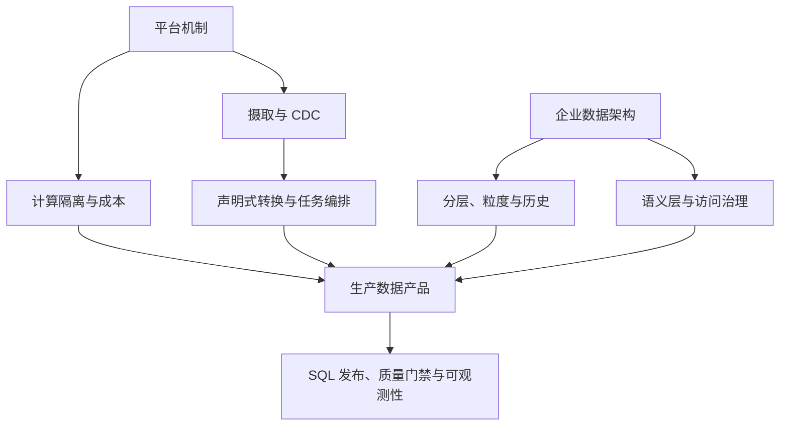

# Snowflake 系统学习与架构实战路线

完整的课程目录、8 门 Coursera 课程模块对照、知识骨架、官方文档索引和端到端路线已整理到 [Snowflake 独立课程 Roadmap](snowflake-course-roadmap.md)。本页保留快速地图与重点实践。

## 学习地图

### 1. 平台机制与仓库治理

理解存储、虚拟仓库与 Cloud Services 的职责。仓库规模主要影响单查询计算资源，多集群扩展偏向并发吞吐；都不能替代 SQL 和数据扫描分析。按 BI、ETL、探索分析的隔离需求分别配置，再用查询历史、负载与费用验证。

练习：`sf-architecture-layer-boundary-01`、`sf-warehouse-workload-isolation-02`。官方材料：[平台架构](https://docs.snowflake.com/en/user-guide/intro-key-concepts)、[成本控制](https://docs.snowflake.com/en/user-guide/cost-controlling-controls)。

### 2. 摄取、CDC 与转换调度

`COPY INTO` 适合批量文件；Snowpipe 面向 Stage 中持续到达的文件；Snowpipe Streaming 用于直接行级摄取。Streams 通过 offset 与变更跟踪暴露 CDC 记录，Tasks 调度/触发 SQL 或存储过程。Dynamic Tables 用声明式 SQL 表达转换，`TARGET_LAG` 是新鲜度目标，不是刷新定时器或无条件 SLA。

练习：`sf-file-ingestion-paths-03`、`sf-streams-tasks-cdc-04`、`sf-dynamic-table-target-lag-05`。官方材料：[数据加载](https://docs.snowflake.com/en/user-guide/data-load-overview)、[Snowpipe](https://docs.snowflake.com/en/user-guide/data-load-snowpipe-intro)、[Snowpipe Streaming](https://docs.snowflake.com/en/user-guide/snowpipe-streaming/data-load-snowpipe-streaming-overview)、[Streams](https://docs.snowflake.com/en/user-guide/streams-intro)、[Tasks](https://docs.snowflake.com/en/user-guide/tasks-intro)、[Dynamic Table target lag](https://docs.snowflake.com/en/user-guide/dynamic-tables/target-lag)。

### 3. 企业数据架构与历史

定义 Raw、Conformed、Curated 的责任，再设计事实表粒度、维度关系和历史有效时间。Raw 保留受治理源记录与摄取元数据；Conformed 统一实体；Curated 发布消费契约。不同粒度事实表连接可能引发 fanout，不能依赖 `DISTINCT` 修复金额错误。Time Travel 不能当成无限期业务历史库；多年重算需留存策略、业务键、有效时间、幂等和对账规则。

练习：`da-enterprise-data-zones-06`、`da-dimensional-grain-07`、`da-history-retention-replay-08`。

### 4. 语义治理与数据安全

用可版本化语义定义集中维护指标、维度、关系、粒度与可加性边界；通过验证问题测试关联路径和聚合结果。语义层不会自动修复底层重复或越权访问。访问治理组合 RBAC、列脱敏和行访问策略，并保留最小权限、所有者审批和审计。

练习：`da-semantic-layer-design-09`、`da-access-governance-10`。官方材料：[Semantic Views](https://docs.snowflake.com/en/user-guide/views-semantic/creating)、[最佳实践](https://docs.snowflake.com/en/user-guide/views-semantic/best-practices)、[访问控制](https://docs.snowflake.com/en/user-guide/security-access-control-overview)。

### 5. SQL 工程化与生产运行

将 DDL、视图、任务和语义定义纳入 Git，通过审查、自动校验、环境配置、受控发布和漂移检测形成闭环。质量门禁组合业务断言、源到目标对账、新鲜度与分布监控。增量管道定义稳定事件键、去重冲突规则、迟到窗口和回补策略。将源事件、摄取/可查询时间、Query Profile、模型版本与血缘联系起来；日志遵循最小必要和脱敏原则。

练习：`de-sql-release-engineering-11`、`de-incremental-idempotency-12`、`de-data-quality-contracts-13`、`de-warehouse-cost-control-14`、`de-observability-lineage-15`。

### 6. SQL、排错与性能诊断题集

参考公开的 [PostgreSQL Full-Day Training](https://github.com/Snowflake-Labs/postgres-full-day-training) 的 SQL、运维和调优主题，新增 200 道 Snowflake 语义的简单/中级题，覆盖 SQL 粒度与窗口函数、半结构化数据、DML/CDC、Time Travel、查询历史/Profile、仓库并发、缓存、微分区、优化服务、RBAC 和成本治理。PostgreSQL 专属机制不会直接套用到 Snowflake。

题集与逐题映射：[200 道题及覆盖矩阵](snowflake-postgres-full-day-200.md)。建议在完成基础 SQL 与仓库治理后，按 `sf-pgtd-001`–`sf-pgtd-200` 逐主题训练；每题都有选择和开放回答形式，可结合 Snowflake 官方文档验证机制、边界和成本假设。

## 端到端案例

**供应商文件入仓：** 从对象存储进入 Raw，保存批次和时间元数据；按到达频率选择 COPY INTO 或 Snowpipe，验证结构与业务约束，不合格数据隔离；转换至 Conformed，发布 Curated 前核对源/目标行数、拒绝数、关键金额及新鲜度。测试重复文件、损坏文件、迟到批次和失败重跑。

**订单 CDC 与历史修正：** 以稳定订单键和事件版本定义冲突处理，幂等 MERGE 到标准化表；迟到事件区分事件时间与处理时间，设置回补窗口；明确 offset、目标更新事务与重试边界，最后按业务日核对笔数和金额。

**SQL 与语义定义持续交付：** 将 DDL、转换 SQL、任务和 Semantic View 纳入 Git；PR 执行质量检查，测试环境执行样本对账和黄金查询，再以最小权限身份按顺序部署；上线后核验对象定义、刷新状态、指标和权限策略，监控实际对象漂移。

**完成标准：** 能解释平台分层；为 BI/ETL 设计仓库隔离；在 COPY INTO、Snowpipe、Snowpipe Streaming、Streams/Tasks 和 Dynamic Tables 间做有约束的选择；解释事实粒度和历史留存；构建版本化语义、安全策略与可重复 SQL 发布流程。
